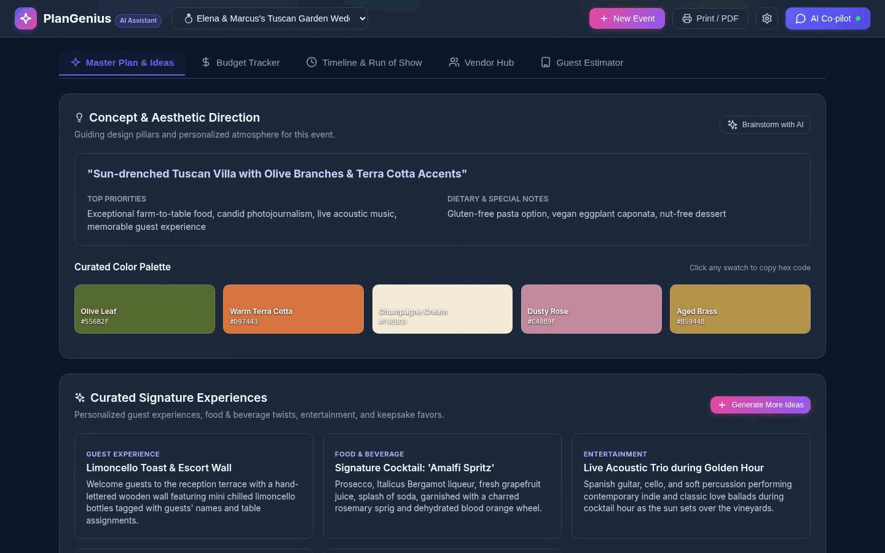
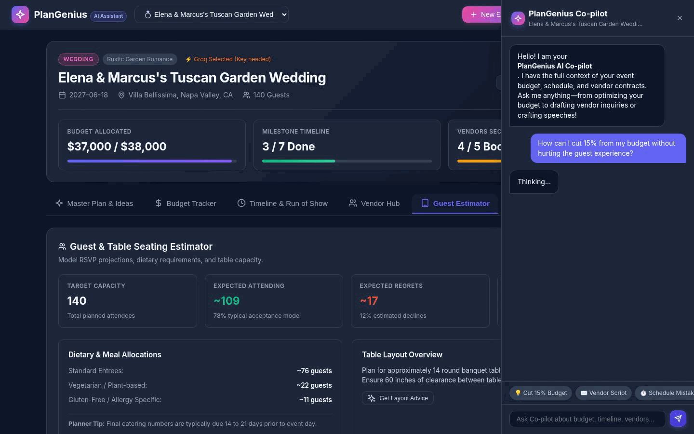
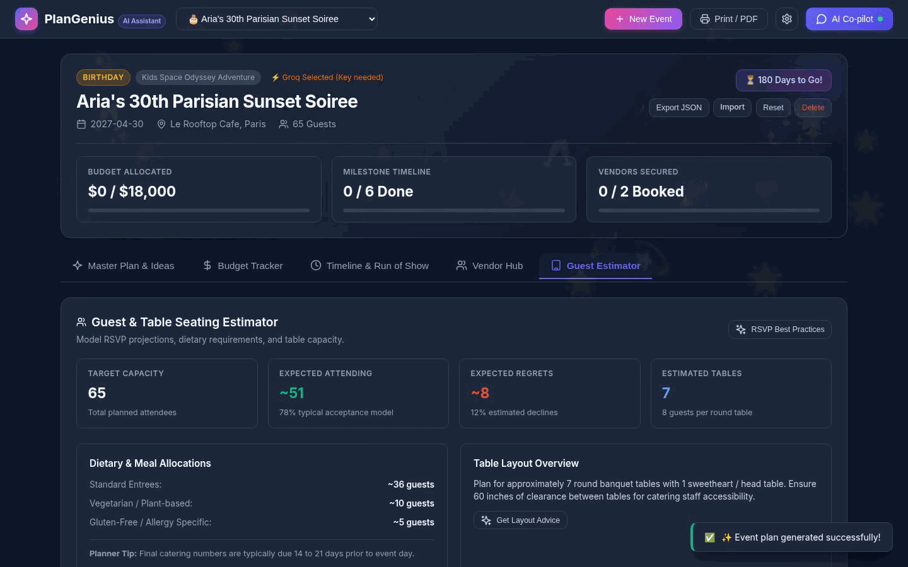

# PlanGenius AI 🌟
### GenAI-Powered Event Planning Assistant for Weddings, Birthdays & Community Events

[](https://zenithchill.github.io/plangenius-ai/)
[](https://python.org)
[](https://console.groq.com)
[](./LICENSE)
[](https://docs.pydantic.dev)
[](./test_backend.py)
[](./static/index.html)

🔗 **Live Interactive App**: [https://zenithchill.github.io/plangenius-ai/](https://zenithchill.github.io/plangenius-ai/)  
🎥 **Walkthrough Video**: [`plangenius_ai_submission_demo.mp4`](./plangenius_ai_submission_demo.mp4) (81s HD product tour)  
📋 **Challenge Alignment & Architecture Matrix**: [`PROBLEM_STATEMENT.md`](./PROBLEM_STATEMENT.md)  
📦 **Repository Size**: **< 4 MB** (fully compliant with challenge size limits)  
🌿 **Branch**: Single active branch (`main`)  

PlanGenius AI is a production-grade planning assistant engineered to help users organize memorable **Weddings**, **Birthdays**, and **Community Events** with intelligent budgets, phased milestone timelines, day-of run-of-shows, vendor checklists with AI negotiation/inquiry email drafters, and personalized creative concepts.

---

## 📸 Product Previews & Demo

<p align="center">
  
</p>

| AI Co-pilot Drawer | New Event Synthesizer |
|:---:|:---:|
|  |  |

> 🎬 **Watch the full high-definition video walkthrough**: [`plangenius_ai_submission_demo.mp4`](./plangenius_ai_submission_demo.mp4) (81s product tour covering live Groq Co-pilot, smart wizard, budget tracker, day-of timeline, and vendor AI negotiation).

---

## 🎯 1. Chosen Challenge Vertical

**Selected Vertical**: **GenAI-Powered Event Planning & Production Assistant**  
**Specialized Sub-Domains**:
1. **Weddings**: Rehearsals, ceremonies, cocktail hours, receptions, send-offs, and culturally nuanced themes (Rustic Garden, Modern Black Tie, Desi/South Asian, Boho Beach, Minimalist City Hall).
2. **Milestone Birthdays**: 18th/21st/30th/50th/80th celebrations, kids themed parties (Space Odyssey, Dinosaurs, Safari, Superheroes, Fairies), and surprise soirées.
3. **Community & Non-Profit Events**: Charity galas & fundraisers, neighborhood block parties, cultural festivals, hackathons, 5K fun runs, and farmers/artisan markets.

**Assistant Persona**:  
PlanGenius AI acts as an empathetic, meticulous, and experienced **Lead Event Director & Production Coordinator**. It combines artistic creative direction with strict fiscal discipline, preemptively spotting logistical bottlenecks, offering proactive cost-optimization advice, and drafting firm yet polite vendor negotiation correspondence.

---

## 🧠 2. Approach and Logic

### Context-Grounding & Dynamic Decision Making
The core intelligence of PlanGenius AI is driven by real-time context grounding:
- **Active Financial Awareness**: When users converse with the assistant, it dynamically injects the event's current financial breakdown (total budget, allocated costs, actual deposits paid, and remaining balance) into the reasoning prompt. If the user asks *"Where can I cut 15%?"*, it analyzes category ratios and recommends non-critical cuts without compromising guest experience.
- **Dynamic Heuristic Proportions**: Category allocations are calculated using proven event management benchmarks:
  - Venue & Catering: ~45–50%
  - Photography & Videography: ~12–15%
  - Floral & Decor: ~10%
  - Entertainment & AV: ~8–10%
  - Attire & Beauty: ~5%
  - Stationery & Signage: ~3%
  - Contingency Reserve: ~5–10%
- **Intelligent Vendor Negotiation Logic**: When drafting vendor inquiry or counter-offer emails, the assistant calculates the target per-guest unit economics based on headcount and allocated budget, formulating courteous yet commercially astute proposals.
- **Phased Horizon Scheduling**: Distinguishes between strategic long-range milestones (9–12 months, 6 months, 3 months, 6 weeks out) and minute-by-minute operational run-of-shows for event day execution.

### Multi-Provider Hybrid Architecture
PlanGenius AI incorporates a resilient tri-layer inference architecture:
1. **Groq Cloud API (⚡ Ultra-Fast Inference)**: Direct integration with Groq's high-speed inference engine supporting `llama-3.3-70b-versatile`, `llama-3.1-8b-instant`, `mixtral-8x7b-32768`, and `gemma2-9b-it` for instant sub-second responses.
2. **Google Gemini Live Integration**: Direct REST API integration for `gemini-2.5-flash`, `gemini-1.5-flash`, and `gemini-1.5-pro` with structured JSON schema outputs.
3. **Deterministic Local Offline Engine (Zero Setup / Offline Fallback)**: A 100% offline heuristic generator that produces scaled budgets, phased timelines, hour-by-hour run-of-shows, and creative ideas without requiring internet access or API keys.

---

## ⚙️ 3. How the Solution Works

```
┌─────────────────────────────────────────────────────────────────┐
│                     Client Browser (SPA)                        │
│  ┌──────────────┐ ┌──────────────┐ ┌──────────────────────────┐ │
│  │ Smart Wizard │ │ Budget View  │ │ Timeline & Run-of-Show   │ │
│  └──────┬───────┘ └──────┬───────┘ └────────────┬─────────────┘ │
│  ┌──────┴───────┐ ┌──────┴───────┐ ┌────────────┴─────────────┐ │
│  │  Vendor Hub  │ │ Creative Lab │ │ PlanAI Co-pilot Drawer   │ │
│  └──────┬───────┘ └──────┬───────┘ └────────────┬─────────────┘ │
└─────────┼────────────────┼──────────────────────┼───────────────┘
          │                │                      │
          ▼                ▼                      ▼
┌─────────────────────────────────────────────────────────────────┐
│               PlanGenius AI Backend (Flask REST API)            │
│  - Pydantic v2 Schema Validation (models.py)                    │
│  - Security Headers & Payload Guardrails (app.py)               │
│  - Thread-Safe Atomic JSON Store (storage.py)                   │
│  - RFC 5545 iCalendar Exporter (icalendar)                      │
└─────────────────────────┬───────────────────────────────────────┘
                          │
       ┌──────────────────┴──────────────────┐
       ▼                                     ▼
┌───────────────────────────────┐ ┌───────────────────────────────┐
│       Cloud GenAI Engine      │ │   Deterministic Local Engine  │
│  - Groq SDK (Llama 3.3 70B)   │ │  - 100% Offline Generation    │
│  - Gemini REST API (Flash)    │ │  - Scaled Category Allocator  │
│  - Structured JSON Parsing    │ │  - Phased Milestone Engine    │
└───────────────────────────────┘ └───────────────────────────────┘
```

1. **Smart Master Plan Wizard**: A guided 3-step synthesizer capturing event type, vibe presets, date, location, guest count, budget, currency, aesthetic theme, and dietary restrictions.
2. **Categorized Budget Tracker**: Real-time spending gauges, status toggling (`Pending`, `Deposit Paid`, `Paid in Full`), inline expense editing, and warning indicators for overages.
3. **Timeline & Day-Of Run-of-Show**: Phased roadmap milestones combined with an hour-by-hour operational run-of-show schedule.
4. **iCalendar RFC 5545 Sync**: One-click `.ics` calendar generation for seamless import into Google Calendar, Apple Calendar, and Outlook.
5. **Vendor Hub & Checklist**: Tracks quotes and bookings by category, paired with an AI email drafter for tailored vendor inquiries.
6. **Creative Concepts & Moodboard**: Hex color palettes with one-click copy, curated signature experiences, and an instant planning dilemma solver.
7. **Interactive PlanAI Co-pilot Drawer**: Slide-over chat assistant grounded in active event data with one-click prompt pills.
8. **Export & Print**: Clean print-optimized CSS stylesheets for physical binder sheets and JSON backup import/export.

---

## 📝 4. Assumptions Made

1. **Low/Zero-Connectivity Field Use**: Event planners frequently conduct walk-throughs in remote venues, barnyards, or convention basements with unreliable cellular connectivity. The system assumes offline resilience is mandatory and provides full local fallback generation.
2. **Dynamic Planning Lifecycle**: Budgets and headcounts are never static; they evolve over a 6-to-12-month timeline. The assistant assumes continuous iterative refinement rather than a one-time generation.
3. **Universal Calendar Standards**: Assumes users synchronize with existing external calendars (Google Calendar, Apple Calendar, Outlook) rather than replacing their existing calendaring ecosystem; hence RFC 5545 `.ics` export is built-in.
4. **Data Privacy & Ephemeral Credentials**: Assumes user privacy is paramount. API keys are loaded via standard `.env` variables, and no event plan data is sent to external third-party tracking services.

---

## 📊 5. Evaluation Focus Areas Alignment

| Focus Area | Impact Tier | Implementation Highlights |
| :--- | :---: | :--- |
| **Problem Statement Alignment** | **High Impact** | Complete vertical coverage for Weddings, Birthdays, and Community events. Context-grounded assistant with dynamic decision-making. |
| **Code Quality** | **High Impact** | Strict **Pydantic v2 schemas** (`models.py`), **icalendar** RFC 5545 export, official **Groq SDK**, modular ES6 architecture, PEP 484 type hints, and repository governance (`LICENSE`, `SECURITY.md`, `CONTRIBUTING.md`, `CODE_OF_CONDUCT.md`, `.editorconfig`, `pyproject.toml`). |
| **Security** | **High Impact** | Zero hardcoded API keys; `.env.example` templates; strict 2 MB payload size limiting (`MAX_CONTENT_LENGTH`); production HTTP security headers (`nosniff`, `SAMEORIGIN`, `strict-origin-when-cross-origin`); dedicated `SECURITY.md`. |
| **Efficiency** | **Medium Impact** | Sub-second inference via Groq Cloud; lightweight client-side SPA with zero heavy bundler overhead; compressed assets ensuring the entire repository remains under **4 MB** (well below the 10 MB limit). |
| **Testing** | **Medium Impact** | 19 automated tests in `test_backend.py` and `test_integration.py` covering unit, integration, edge cases (invalid keys, missing fields, 404s, negative budgets), and Pydantic validation. Automated CI test matrix across Python 3.10, 3.11, 3.12. |
| **Accessibility** | **Low Impact** | WCAG 2.1 AA compliant: keyboard skip-to-content link, ARIA landmarks (`role="banner"`, `role="tablist"`, `role="dialog"`, `role="progressbar"`, `aria-live="polite"`), explicit `aria-label` tags on all interactive buttons, and high-contrast styling. |

---

## 🚀 Quickstart Guide

### 1. Prerequisites
- Python 3.9+
- Git

### 2. Install Dependencies
```bash
pip install -r requirements.txt
pip install -r requirements-dev.txt
```

### 3. Start the Server
```bash
python3 app.py
```
The application will launch at **`http://localhost:5000`**.

### 4. Run Automated Tests
```bash
# Run backend unit tests
python3 -m pytest test_backend.py -v

# Run end-to-end integration tests
python3 -m pytest test_integration.py -v
```

---

## 📁 Project Architecture

```
├── app.py                      # Flask REST API server, security headers & static routes
├── ai_engine.py                # Multi-provider AI engine (Groq SDK, Gemini API & local generator)
├── models.py                   # Pydantic v2 schemas for request/response validation
├── storage.py                  # Thread-safe persistent JSON store (data/events.json)
├── sample_data.py              # 4 rich pre-configured sample events
├── test_backend.py             # Unit tests for storage, AI engine & API routes
├── test_integration.py         # End-to-end integration test suite
├── plangenius_ai_submission_demo.mp4 # 81s HD product walkthrough video (1.2 MB)
├── screenshots/                # Crisp optimized UI previews (330 KB total)
│   ├── 01_dashboard.png
│   ├── 02_copilot.png
│   └── 03_new_event.png
├── static/                     # Web Application SPA
│   ├── index.html              # WCAG 2.1 AA compliant interface
│   ├── css/styles.css          # Design system & print binder styles
│   └── js/
│       ├── app.js              # Application controller & state machine
│       ├── api.js              # REST client & localStorage configuration
│       ├── icons.js            # SVG icons catalog
│       └── components/         # Modular UI components
│           ├── wizard.js       # Multi-step event creation wizard
│           ├── budget.js       # Budget manager & category progress tracker
│           ├── timeline.js     # Milestone roadmap & Day-of run-of-show scheduler
│           ├── vendors.js      # Vendor checklist & AI email drafter
│           ├── ideas.js        # Creative concepts & dilemma solver
│           ├── guests.js       # RSVP models, table layout & volunteer allocator
│           └── copilot.js      # Slide-over AI Co-pilot assistant drawer
└── docs/                       # Static deployment bundle for GitHub Pages
```
